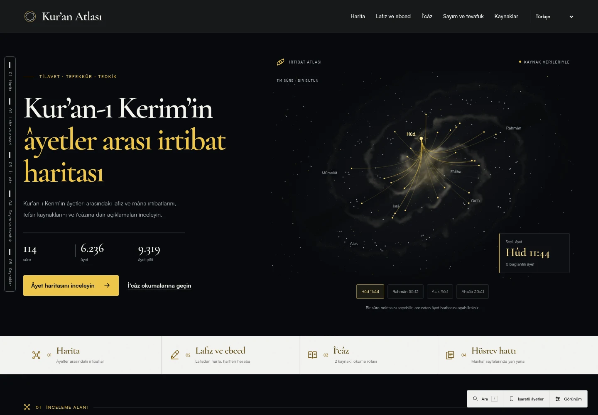
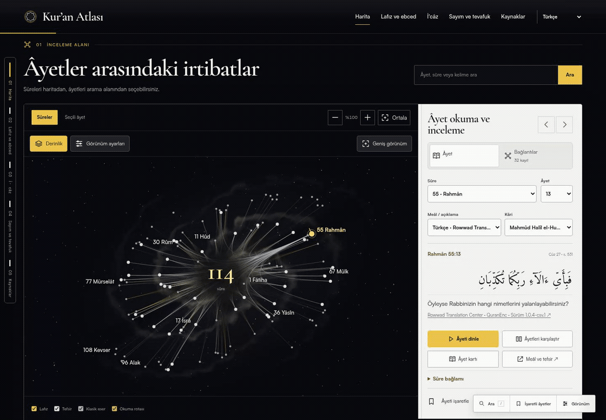
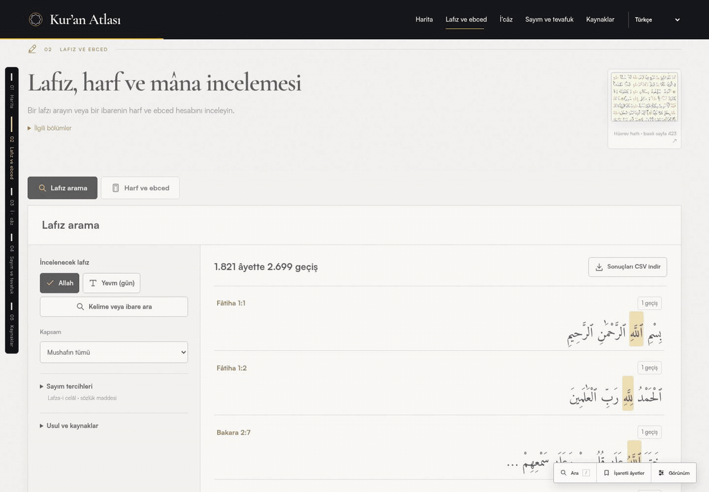
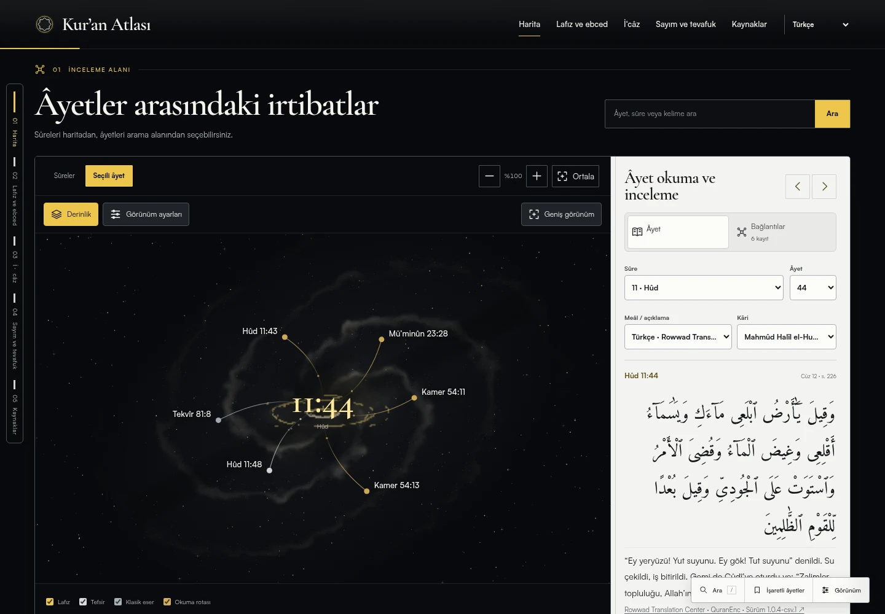
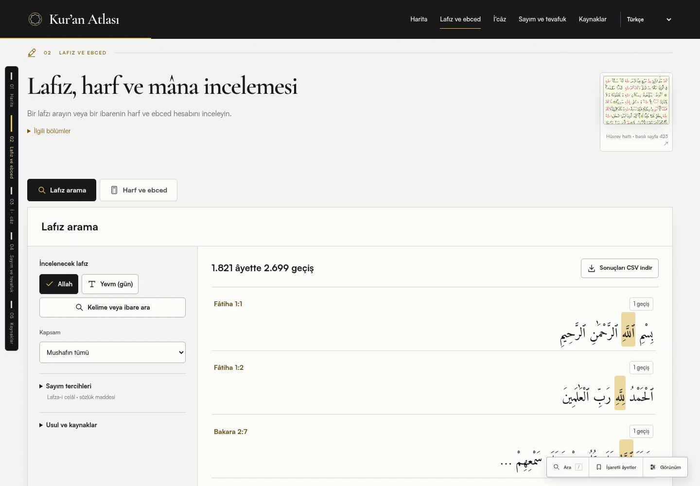
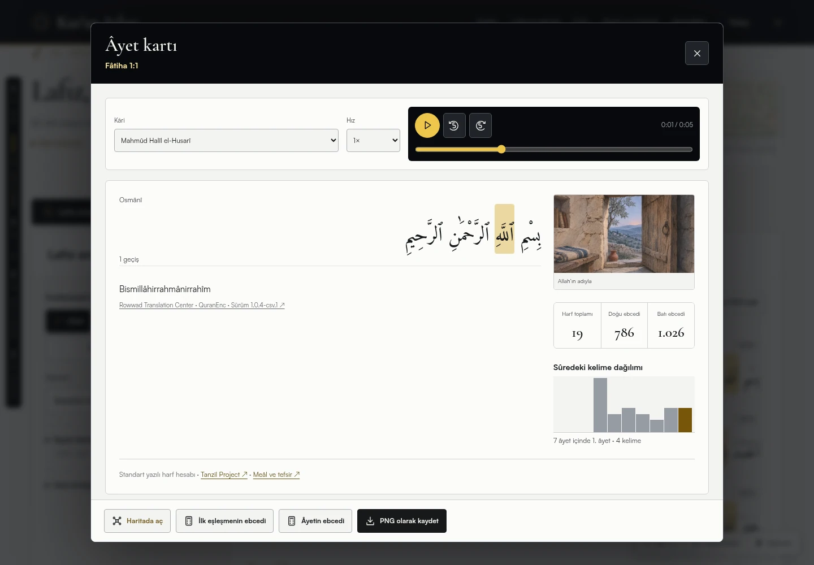
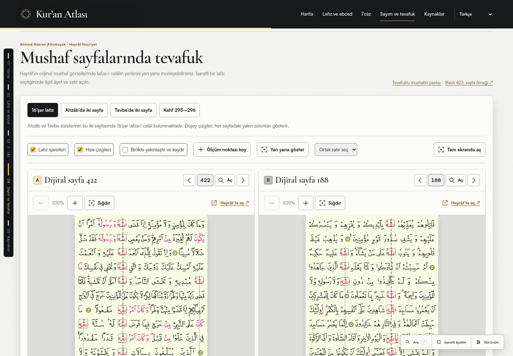
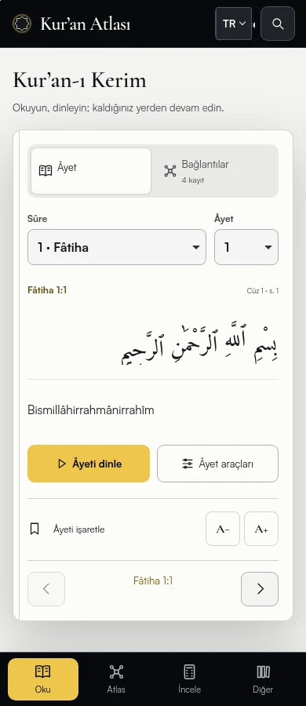

<p align="center">
  
</p>

<h1 align="center">Kur’an Atlası</h1>

<p align="center">
  <strong>Tilavet · Tefekkür · Tedkik</strong><br>
  Kur’an-ı Kerim’in âyetleri arasındaki lafız ve mâna irtibatlarını kaynaklarıyla inceleyin.
</p>

<p align="center">
  <a href="https://quran.bayrameker.com/?lang=tr"><strong>Canlı siteyi aç ↗</strong></a>
  &nbsp;·&nbsp;
  <a href="https://quran.bayrameker.com/?lang=tr#harita">Atlasa geç</a>
  &nbsp;·&nbsp;
  <a href="https://quran.bayrameker.com/?lang=tr#lafiz-labi">Lafız ara</a>
  &nbsp;·&nbsp;
  <a href="#yerelde-calistirma">Yerelde çalıştır</a>
</p>

<p align="center">
  <strong>114</strong> sûre &nbsp; / &nbsp;
  <strong>6.236</strong> âyet &nbsp; / &nbsp;
  <strong>12</strong> okuma rotası &nbsp; / &nbsp;
  <strong>6</strong> arayüz dili
</p>

[](https://quran.bayrameker.com/?lang=tr)

## Âyetten irtibata

Bir sûre seçin, ilgili âyeti okuyun; bağlantıları, meâli ve kaynakları birlikte
inceleyin. Atlas, lafız arama, harf hesabı ve tilavet aynı çalışma akışında
buluşur. Sarı vurgular, koyu galaksi zemini ve açık okuma alanları bu akışa
eşlik eder.

| Alan | Neler yapabilirsiniz? |
| :--- | :--- |
| **İrtibat atlası** | Sûre ve âyetler arasında gezinme; lafız, tefsir, klasik eser ve okuma rotası katmanlarını seçme; yakınlaştırma, geniş görünüm ve yön/eğim/derinlik ayarları. |
| **Lafız, harf ve mâna** | Mushafın tümünde, bir sûrede, sayfada veya seçili âyette lafız arama; sayım tercihlerini inceleme; sonuçları CSV olarak indirme. |
| **Ebced incelemesi** | Âyet veya ibare üzerinde harfleri, Doğu/Batı ebced değerlerini, yazım ve sayım kurallarını birlikte görme. |
| **Tilavet ve karşılaştırma** | Kâri ve hız seçme; oynat/duraklat, konumlandırma ve 5 saniye geri/ileri kontrolleri; iki âyeti sırayla dinleme. |
| **Kaynaklı okumalar** | 12 İ‘câz okuma rotası, âyet karşılaştırmaları ve ilgili kaynaklara geçiş. |
| **Hüsrev hattı** | Mushaf sayfalarını yan yana inceleme; lafız işaretleri, hiza çizgileri ve ölçüm araçlarını kullanma. |

Sayım ve ebced sonuçları seçilen yazım ve kurala göre gösterilir. Yöntem
açıklamaları ve kaynak bağlantıları ilgili inceleme alanlarında bulunur.

## Atlas hareket hâlindeyken

Sûre görünümünden seçili âyete geçiş, kamera ayarları ve bağlantılar sekmesi:

[](https://quran.bayrameker.com/?lang=tr#harita)

**[Atlası canlıda deneyin ↗](https://quran.bayrameker.com/?lang=tr#harita)**

## Lafızdan âyet kartına

Lafız araması ile harf/ebced sekmeleri arasında geçiş yapın. Bir sonucu
açarak âyet kartını, meâli, harf özetini ve tilavet kontrollerini inceleyin.

[](https://quran.bayrameker.com/?lang=tr#sayim)

**[Lafız arama ↗](https://quran.bayrameker.com/?lang=tr#lafiz-labi)**
&nbsp;·&nbsp;
**[Harf ve ebced ↗](https://quran.bayrameker.com/?lang=tr#ebced-labi)**

## Arayüzden görüntüler

Görüntüler ve sessiz GIF kayıtları canlı uygulamadan alınmıştır.
Ekran görüntülerini tam boyutunda açmak için üzerlerine tıklayabilirsiniz.

| İrtibat atlası | Lafız arama |
| :---: | :---: |
| [](docs/media/atlas.webp) | [](docs/media/word-study.webp) |
| **Âyet ayrıntısı ve tilavet** | **Hüsrev hattında inceleme** |
| [](docs/media/verse-detail.webp) | [](docs/media/husrev.webp) |

## Okuma görünümü

Telefon ve tablette **Oku · Atlas · İncele · Diğer** alt menüsüyle doğrudan
ilgili alana geçilir. Okuma ekranında âyet ve meâl öne çıkar; kaynaklar ve
ayarlar ihtiyaç duyulduğunda açılır. Harita üzerindeyken sayfa kaydırılabilir;
tam ekranda tek parmakla sürükleme ve iki parmakla yakınlaştırma kullanılır.
Karşılaştırmalar ve mushaf sayfaları sekmelerle tek tek incelenir.
Mobilde bölümler arasında geçerken kaydırma konumu korunur. Açılır araçlar
arkadaki sayfayı sabitler; arama penceresi klavyenin bıraktığı alana uyum sağlar.

Masaüstü görünümü korunur. Âyet işaretleri, son okuma ve görünüm tercihleri
tarayıcıda saklanır. Yazı boyutu ve zemin dokusu ayarlanabilir; azaltılmış
hareket tercihi gözetilir.

<details>
  <summary><strong>Mobil okuma görünümünü aç</strong></summary>
  <p align="center">
    
  </p>
</details>

<p align="center">
  <a href="https://quran.bayrameker.com/?lang=tr">Türkçe</a> &nbsp;·&nbsp;
  <a href="https://quran.bayrameker.com/?lang=en">English</a> &nbsp;·&nbsp;
  <a href="https://quran.bayrameker.com/?lang=ar">العربية</a> &nbsp;·&nbsp;
  <a href="https://quran.bayrameker.com/?lang=fr">Français</a> &nbsp;·&nbsp;
  <a href="https://quran.bayrameker.com/?lang=es">Español</a> &nbsp;·&nbsp;
  <a href="https://quran.bayrameker.com/?lang=id">Bahasa Indonesia</a>
</p>

<a name="yerelde-calistirma"></a>

## Yerelde çalıştırma

Uygulama statik HTML, CSS ve JavaScript dosyalarından oluşur. Veritabanı veya
API anahtarı gerekmez. Meâl dosyaları paketle birlikte sunulur; tilavet
kayıtları EveryAyah’tan, paket dışında kalan bazı mushaf sayfaları ilgili
yayıncıdan yüklenir.

### Python ile

```sh
git clone https://github.com/bayrameker/quran-atlas.git
cd quran-atlas
python3 -m http.server 8080 --bind 127.0.0.1 --directory public
```

Ardından **[localhost:8080/?lang=tr](http://localhost:8080/?lang=tr)** adresini açın.

### Docker ile

```sh
docker compose -f compose.example.yaml up -d --wait
```

Aynı yerel adreste açılır. Durdurmak için:

```sh
docker compose -f compose.example.yaml down
```

Bu dosya taşınabilir bir yerel kullanım örneğidir. Üretime ait özel
yapılandırmalar ve erişim bilgileri depoya dahil değildir.

<details>
  <summary><strong>Kaynak yapısı ve derleme</strong></summary>

| Yol | İçerik |
| :--- | :--- |
| `src/base.html` | Korunmuş içerik, veri blokları ve asıl uygulama. |
| `src/atlas-experience.*` | Arayüz, okuma tercihleri ve etkileşimler. |
| `src/atlas-cosmos.js` | Canvas galaksi ve nokta yerleşimi. |
| `src/atlas-workbench.*` | Çalışma alanları, ikonlar ve ses kontrolleri. |
| `src/atlas-mobile.*` | Telefon ve tablete özel gezinme, dokunmatik kontroller ve sade görünümler. |
| `src/*copy.json`, `src/palette.json` | Arayüz metinleri ve palet. |
| `src/vendor/` | Yerel font/sprite girdileri ve ilgili lisanslar. |
| `public/` | Çalıştırılabilir site, veri ve lisans dosyaları. |
| `deployment/*.py` | Statik derleme araçları. |
| `docs/media/` | README ekran görüntüleri ve kısa GIF kayıtları. |

Python 3 ve Node.js kuruluysa:

```sh
python3 deployment/build-experience.py
```

Çıktı `deployment/stage/` altında hazırlanır; `public/` otomatik değiştirilmez.
Derleyici âyet/kaynak veri bloklarının korunduğunu kontrol eder ve içerik
hashli varlıklarla gzip kopyalarını üretir.

</details>

## Kaynaklar ve lisanslar

Âyet metinleri, meâller, mushaf görüntüleri ve üçüncü taraf varlıkların
kaynak/atıf koşulları **[public/licenses/](public/licenses/)** altında korunur.
Font ve sprite girdileri için **[src/vendor/](src/vendor/)** dizinine de bakın.

Arayüz fontu **Satoshi**, Indian Type Foundry / Fontshare’a aittir.
İlgili [telif ve lisans bildirimi](public/licenses/SATOSHI-NOTICE.txt) depoda bulunur.
Kaynak dosyalarındaki kullanım ve dağıtım koşulları geçerlidir.

---

<p align="center">
  <strong>Kur’an Atlası</strong><br>
  <a href="https://quran.bayrameker.com/">quran.bayrameker.com ↗</a>
</p>
